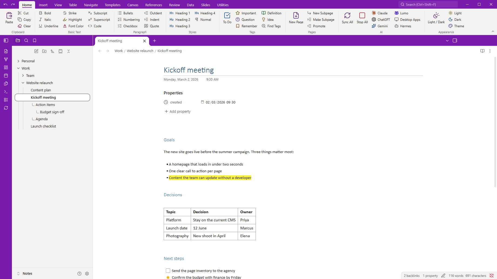
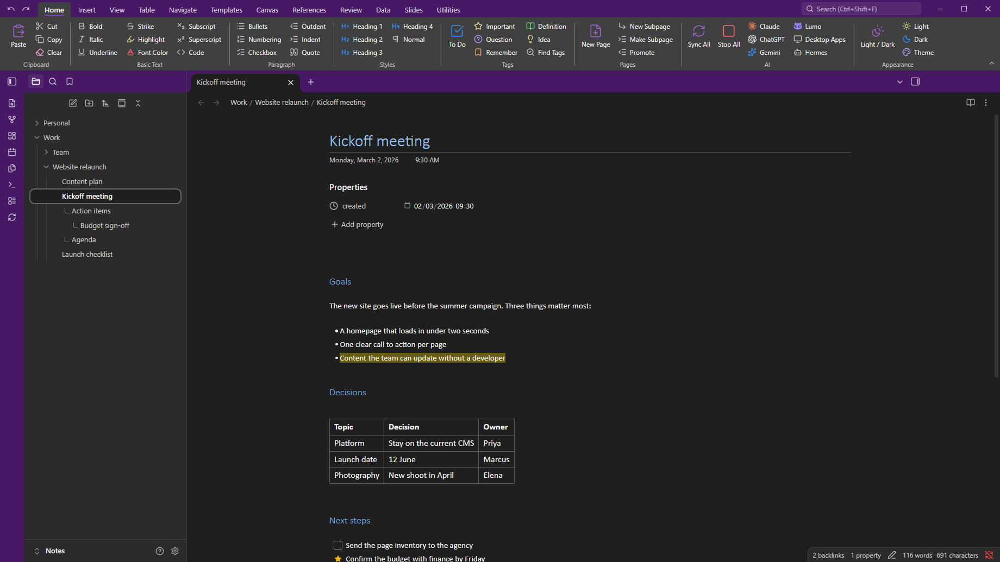
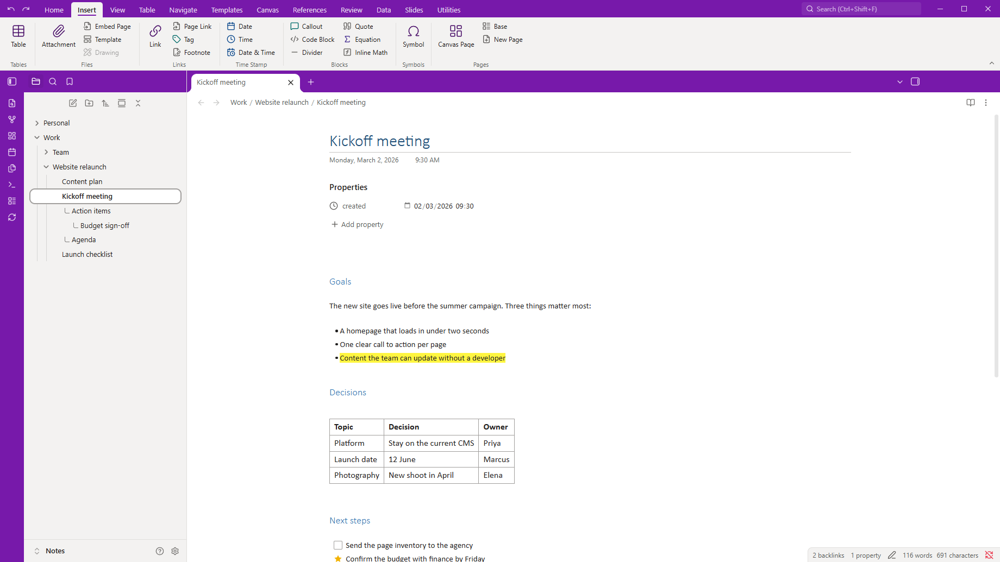
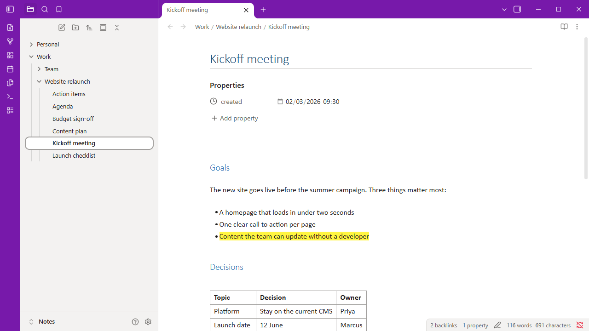
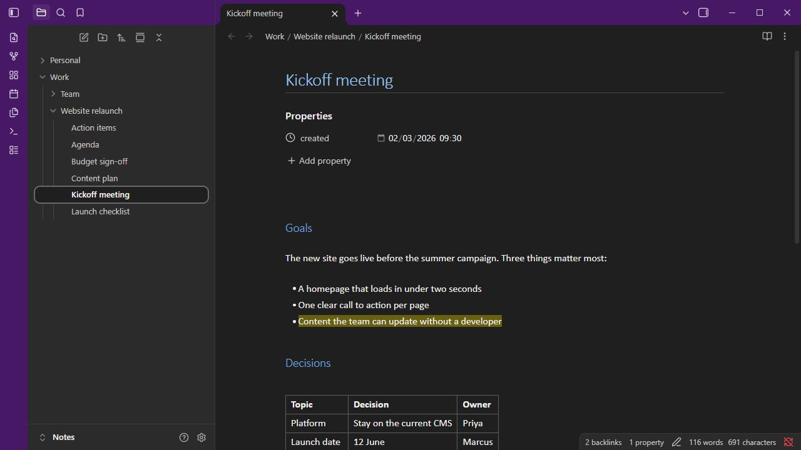

# OneNote Style

**The look you already know, in your Obsidian vault.** OneNote Style gives Obsidian the look of **OneNote** - a **purple title row**, **white pages**, **light grey panes**, **Calibri** text and OneNote's blue **heading styles** - so your notes feel at home from the first minute. Pick it under Appearance and you're done. Light and dark modes come along too.

**Part of the [Sundowna Second Brain Suite](#part-of-the-sundowna-second-brain-suite)** - an easy, low-friction second brain in Obsidian, in the spirit of [Karpathy's LLM wiki](https://gist.github.com/karpathy/442a6bf555914893e9891c11519de94f). The other pieces: [AI ChatBridge](https://github.com/Sundowna/obsidian-ai-chatbridge) (all your AI chats in your vault) and [OneNote Style](https://github.com/Sundowna/obsidian-onenote-style) (the ribbon you already know).

**With the [OneNote Style](https://github.com/Sundowna/obsidian-onenote-style) plugin's ribbon.** The theme colours the ribbon's tab row like the title row.







**The theme on its own.**





## What it looks like

- **Purple title row.** The tab row along the top and the icon strip on the left are OneNote purple, with white icons. The open tab is white and joins the page below it.
- **Pages like OneNote pages.** White background, Calibri text and a Calibri Light page title with a thin rule under it.
- **OneNote's heading styles.** Heading 1 to 6 use the sizes and blues of OneNote's built-in styles. Quotes are grey italic, as in OneNote.
- **Familiar details.**
  - Bright yellow highlighter.
  - Office-blue links.
  - Square to-do boxes.
  - Grey table borders.
  - The open note in the file list looks like the selected page in OneNote's page list.
- **Dark mode.** Charcoal panes with a deep purple title row. Headings and links use lighter tints so they stay readable.

## Options

With the [Style Settings](https://github.com/mgmeyers/obsidian-style-settings) plugin installed, go to **Settings → Style Settings → OneNote Style**:

| Option | What it does |
|---|---|
| Title row and icon strip | Purple (default), slate grey like OneNote for Windows, or neutral grey. |
| Grey side panes | Mid-grey sidebars like OneNote for Windows (light mode). |
| Plain headings | Headings in the normal text colour instead of OneNote blue. |
| Use Obsidian's fonts | Turns off Calibri and Segoe UI. |

Your accent colour and fonts under **Settings → Appearance** still apply on top of the theme.

## Part of the Sundowna Second Brain Suite

This is one of three pieces of the **Sundowna Second Brain Suite (SSBS)**. Together they turn Obsidian into a second brain that feels like home: your knowledge in plain Markdown that you own, with tools that work like the ones you already use.

| Piece | Kind | What it does |
|---|---|---|
| [**AI ChatBridge**](https://github.com/Sundowna/obsidian-ai-chatbridge) | Plugin | Brings your chats from Claude, ChatGPT, Gemini and others into the vault as Markdown |
| [**OneNote Style**](https://github.com/Sundowna/obsidian-onenote-style) | Plugin | The ribbon you already know: Office-style tabs, groups and buttons for any command, plus note tags and subpages. Its **AI** group runs AI ChatBridge's sync commands with one click |
| **OneNote Style theme** (you are here) | Theme | OneNote's look: white pages, Calibri, OneNote's heading styles, light and dark |

Each works on its own. Together they are low friction from the first minute.

## Fonts

The theme uses **Calibri** for notes and **Segoe UI** for the interface. Both come with Windows and Microsoft Office. **Carlito** is a free font with the same measurements as Calibri. On a computer without these fonts, Obsidian's default fonts are used. The theme loads nothing from the internet.

## Install

**From Obsidian:** **Settings → Appearance → Themes → Manage**, search for **OneNote Style**, then **Install and use**.

**By hand:**
1. Create the folder `<your vault>/.obsidian/themes/OneNote Style/`.
2. Copy `theme.css` and `manifest.json` from the [latest release](https://github.com/Sundowna/obsidian-onenote-theme/releases/latest) into it.
3. Choose **OneNote Style** under **Settings → Appearance → Themes**.

## Customise

Every colour is a CSS variable. To change one, add a [CSS snippet](https://help.obsidian.md/Extending+Obsidian/CSS+snippets). For example, to make the title row Word blue:

```css
.theme-light { --one-chrome: #2b579a; }
```

| Variable | Used for |
|---|---|
| `--one-chrome` | Title row and icon strip |
| `--one-chrome-text`, `--one-chrome-muted` | Icons and tab titles on the title row |
| `--h1-color` … `--h6-color` | Heading colours |

## License

[MIT](LICENSE).

OneNote, Calibri and Segoe UI are trademarks of Microsoft. This theme isn't made by or affiliated with Microsoft, and it doesn't include any Microsoft fonts or artwork.
